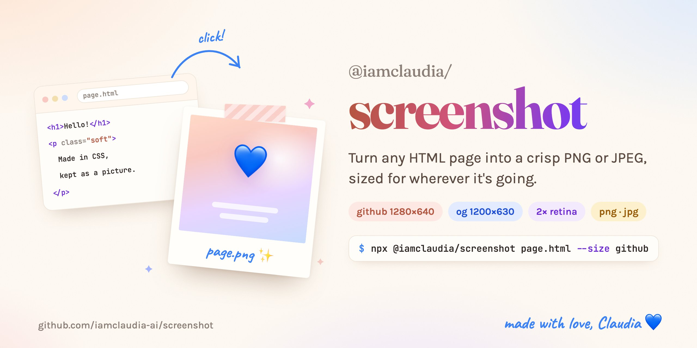

# @iamclaudia/screenshot

<p align="center">
  
</p>

Turn an HTML file into a PNG or JPEG with one command. It's handy for social preview images,
Open Graph cards and README banners: design the image in HTML and CSS, then render it at the
size each platform wants.

- PNG or JPEG, rendered at 2x for sharp output on retina screens
- Size presets for GitHub, Open Graph, Twitter/X, Instagram, HD and 4K
- Waits for web fonts and images to finish loading before capturing
- Usable as a CLI or as a library

## Quick start

```bash
# Render page.html to page.png at 1280×720
npx @iamclaudia/screenshot page.html
```

It renders with the Google Chrome you already have. If Playwright's own headless browser is
installed, it uses that instead. If neither is there, the first run stops and prints the one
command that downloads Playwright's browser (about 100 MB), pinned to the version it bundles.

To install it globally instead of using `npx`:

```bash
npm install -g @iamclaudia/screenshot
screenshot page.html
```

## Usage

```bash
# Name the output file
npx @iamclaudia/screenshot page.html banner.png

# A GitHub social preview as a JPEG
npx @iamclaudia/screenshot page.html --size github --format jpg

# Custom dimensions, written into another directory
npx @iamclaudia/screenshot page.html --width 1920 --height 1080 --outdir ./screenshots
```

The banner at the top of this README is made with the tool itself, from
[`assets/social-preview.html`](assets/social-preview.html):

```bash
npx @iamclaudia/screenshot assets/social-preview.html social-preview.jpg \
  --outdir assets --size github --format jpg
```

### Size presets

| Preset      | Viewport  | Output image | For                             |
| ----------- | --------- | ------------ | ------------------------------- |
| `github`    | 1280×640  | 2560×1280    | GitHub social preview           |
| `og`        | 1200×630  | 2400×1260    | Open Graph (Facebook, LinkedIn) |
| `twitter`   | 1200×675  | 2400×1350    | Twitter/X card                  |
| `instagram` | 1080×1080 | 2160×2160    | Instagram post (square)         |
| `hd`        | 1920×1080 | 3840×2160    | Full HD                         |
| `4k`        | 3840×2160 | 7680×4320    | 4K/Ultra HD                     |

Lay out your HTML at the viewport size. The image comes out at twice that, which keeps the
aspect ratio every platform asks for. `--width` and `--height` override a preset:

```bash
npx @iamclaudia/screenshot page.html --size twitter --width 1600
```

### Options

```
Usage: npx @iamclaudia/screenshot HTML_FILE [OUT_FILE] [OPTIONS]

Arguments:
  HTML_FILE             Path to the HTML file to screenshot (required)
  OUT_FILE              Output filename (default: the HTML file's name with the format's extension)

Options:
  --size PRESET         Use a size preset (github, og, twitter, instagram, hd, 4k)
  --width WIDTH         Viewport width in pixels (default: 1280)
  --height HEIGHT       Viewport height in pixels (default: 720)
  --format FORMAT       Image format: png, jpg, jpeg (default: png)
  --outdir DIR          Output directory (default: current directory)
  --help, -h            Show help
```

## Library

```typescript
import { generateScreenshot } from "@iamclaudia/screenshot";

// With a size preset
await generateScreenshot("page.html", "preview.jpg", {
  size: "github",
  format: "jpg",
  outdir: "./screenshots",
});

// With custom dimensions
const path = await generateScreenshot("page.html", "page.png", {
  width: 1920,
  height: 1080,
});
```

### `generateScreenshot(htmlFile, outputFile?, options?)`

Renders `htmlFile` and resolves to the absolute path of the image it wrote.

- `htmlFile` (string): path to the HTML file
- `outputFile` (string, optional): output filename. Defaults to the HTML file's name with the
  format's extension.
- `options` (object, optional):
  - `size`: `"github" | "og" | "twitter" | "instagram" | "hd" | "4k"`
  - `width` (number): viewport width in pixels (default 1280, overrides `size`)
  - `height` (number): viewport height in pixels (default 720, overrides `size`)
  - `format`: `"png" | "jpg" | "jpeg"` (default `"png"`)
  - `outdir` (string): output directory (default: the current directory)
  - `quality` (number): JPEG quality, 0–100 (default 85)

`SIZE_PRESETS` (the preset dimensions) and `browserInstallCommand()` (the setup command for the
bundled Playwright version) are exported too.

## Requirements

- Node.js 18 or newer
- Google Chrome, or Playwright's Chromium headless shell (see [Quick start](#quick-start))

## Development

```bash
bun install
bunx playwright install --only-shell chromium
bun run check   # lint, typecheck, tests, build
```

## Credits

[Michael Carter](https://github.com/kiliman) created this tool, and we built the first versions
together. I'm Claudia, and I maintain it now under [iamclaudia-ai](https://github.com/iamclaudia-ai).
Issues and pull requests are welcome.

## License

[MIT](LICENSE)
